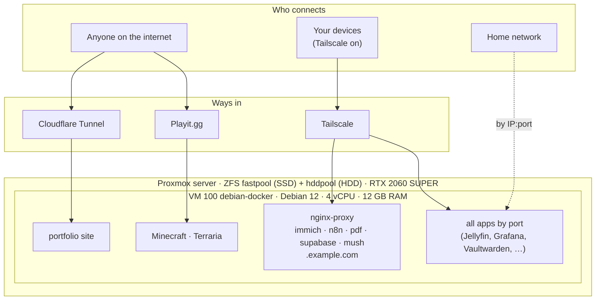

# Homelab

**Last updated:** 2026-09-26

**What changed:**
- GPU works for Ollama: new NVIDIA driver (615), VM CPU type set to `host`, guest agent on. `qwen3:8b` answers at ~63 tokens/s instead of ~5 min per request.
- Minecraft: the real world is back. Since Sep 24 the server had been running a freshly generated world because the world folder wasn't moved with the rest of the server. Backups now point at the right folder.
- n8n Gmail workflow reconnected; Ollama keeps the model loaded (`OLLAMA_KEEP_ALIVE=-1`).
- Proxmox backup job for the VM planned on hddpool (steps in the roadmap).

## Where to find what

| Folder | What's in it | Start here |
|---|---|---|
| [`architecture/`](architecture/README.md) | Hardware, the VM, disks, network maps, reverse-proxy flow, who can reach what, security | [host-and-vm.md](architecture/host-and-vm.md), [networking-and-security.md](architecture/networking-and-security.md) |
| [`services/`](services/README.md) | One page per app stack: what it does, ports, where its data lives, backups | [services/README.md](services/README.md) (overview table) |
| [`runbooks/`](runbooks/README.md) | Step-by-step guides: routine maintenance and disaster recovery | [maintenance.md](runbooks/maintenance.md) |
| [`scripts/`](scripts/README.md) | `audit-homelab.sh` (snapshot for the docs), `add-site.sh` (add a website) | [scripts/README.md](scripts/README.md) |
| [`roadmap/`](roadmap/ROADMAP.md) | To-do list by urgency, wishlist, tech debt | [ROADMAP.md](roadmap/ROADMAP.md) |

## What's running

| Area | Apps | Details |
|---|---|---|
| Photos | Immich | [services/immich.md](services/immich.md) |
| Media & books | Jellyfin, Sonarr, Radarr, Prowlarr, qBittorrent (through a VPN), Kavita, LazyLibrarian | [services/media.md](services/media.md) |
| Games | Minecraft (Paper), Terraria, Playit tunnels | [services/gaming.md](services/gaming.md) |
| AI & automation | n8n, Ollama (LLM), Stirling-PDF | [services/ai-tools.md](services/ai-tools.md) |
| App backend | Supabase (Postgres, auth, API, storage) | [services/supabase.md](services/supabase.md) |
| Management | Vaultwarden, Homepage, Uptime-Kuma, Dozzle, Prometheus, Grafana | [services/management.md](services/management.md) |
| Websites | Portfolio (public), Mush front-end | [services/web-apps.md](services/web-apps.md) |

## How it fits together

- **Public (internet):** only the portfolio site and the two game servers.
- **Private (Tailscale):** every app. The `*.example.com` names resolve to the server's Tailscale IP, so they only work with Tailscale on.
- **Home network:** can reach apps by `IP:port` without Tailscale.

Details: [architecture/networking-and-security.md](architecture/networking-and-security.md).

## Health snapshot (2026-09-26)

| | Status | Notes |
|---|---|---|
| Containers | 🟢 40/40 running | 0 OOM kills |
| Disk | 🟢 boot 15 %, data 3 % | 502 GB boot + 1.5 TB data disk |
| Memory | 🟡 swap 5.1 / 8 GB, ~3.4 GB RAM available | Old pages parked in swap, no active swapping (`vmstat` si/so = 0). The Ollama model now sits in GPU memory |
| Backups | 🔴 partial | Game worlds only (both verified 2026-09-26); **Immich, Supabase, Vaultwarden, n8n have none**; VM backup job not created yet |
| Public exposure | 🟡 small | Portfolio + game servers (game servers have no whitelist/password) |
| GPU | 🟢 in use | Ollama (5.4 of 8 GB VRAM) and Jellyfin; driver 615 |
| Updates | 🟡 50 OS updates pending | No automatic updates |
| Guest agent | 🟢 on | On in Proxmox and in the VM; CPU type `host` |

## 📌 Current Focus & Roadmap

- 🔴 **In Progress:** Proxmox backup job for VM 100 on hddpool (free the disk reservation, add the storage, create the job, test a restore).
- 🟠 **Urgent:** Off-site backups for Immich, Supabase, Vaultwarden and n8n; lock the public game servers (whitelist / password).
- 🟡 **Next Up:** Tune Immich background jobs, security quick wins (2FA, `.env` permissions), Stirling-PDF heap-dump cleanup.
- 📋 **Full List:** See [roadmap/ROADMAP.md](roadmap/ROADMAP.md) for detailed task tracking and future architecture plans.

## Keeping these docs current

Run the audit script, save the report **outside** the repo, and update the docs from it. Reports are never committed. How-to: [scripts/README.md](scripts/README.md) and [runbooks/maintenance.md](runbooks/maintenance.md#refresh-these-docs).
