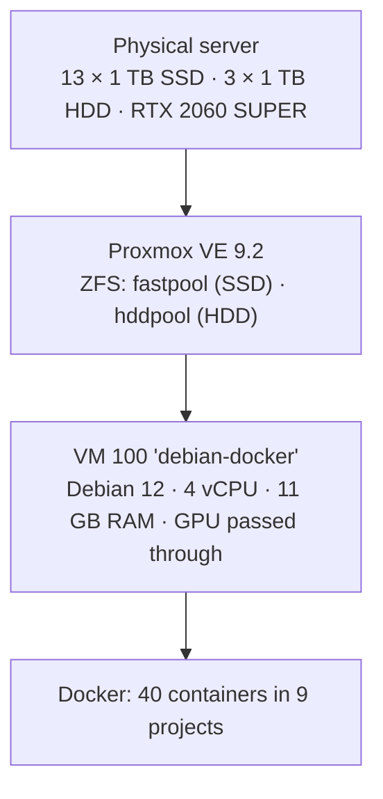
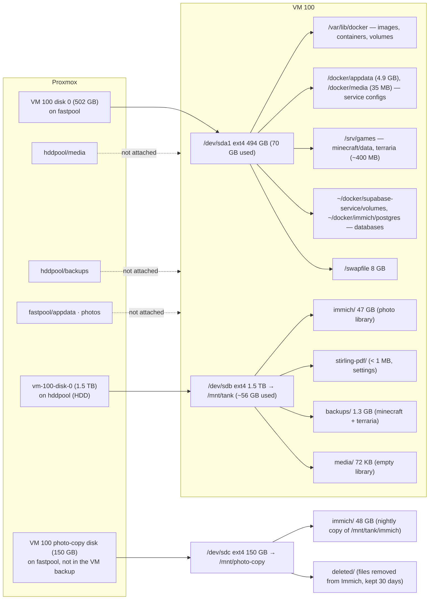

# Host & VM

> The physical Proxmox server and the one Debian VM that runs everything. Last verified 2026-09-26 (from inside the VM). Proxmox-side facts are from the 2026-09-16 inspection unless noted.

## The layers



One VM runs all the Docker containers, rather than one VM or LXC per service. That's a common, sensible homelab design: one OS to patch, one Docker to manage, one GPU owner. The trade-off is that the VM is a single point of failure, which makes VM-level backups important (see the [roadmap](../roadmap/ROADMAP.md)).

## Proxmox host

| Item | Value |
|---|---|
| Proxmox VE | 9.2.x (pve-manager 9.2.4 on 2026-09-16) |
| ZFS `fastpool` | SSD pool, 8.72 TB. Datasets: `appdata`, `photos`, `vms`, and VM 100's boot disk |
| ZFS `hddpool` | HDD pool, **~1.76 TB usable** (checked 2026-09-26; the earlier 2.72 TB was not the usable size). Holds `vm-100-disk-0`, the VM's 1.5 TB data disk. Datasets `backups` and `media` exist but are empty |
| Drives (host `lsblk`, 2026-10-04) | 1 × 256 GB M.2 **SATA** SSD (probably the Proxmox system drive; not NVMe), 11 × 960 GB SAS SSDs (Samsung PM863-class and SanDisk), 3 × 1 TB WD HDDs. Pool membership not recorded yet (`zpool status`) |
| M.2 SSD health (2026-10-04) | SMART PASSED, 0 reallocated / uncorrectable sectors, but **77 `UDMA_CRC_Error_Count`** and **2241 power cycles in 2031 power-on hours**: connection errors, not worn flash. Plan: reseat it, then recheck `smartctl -a /dev/sda` every few days; rising numbers after that mean replace it. `zpool status -x`: all pools healthy |
| GPU | NVIDIA RTX 2060 SUPER 8 GB, PCIe passthrough to VM 100 (`vfio-pci` on the host) |
| Backup jobs | VM 100 nightly at 05:00 to `hddpool-backups`, boot disk only (see [below](#vm-100-backup-working-since-2026-09-27)). The photo-copy disk (`scsi2`) has *Backup* unchecked |

Host RAM (checked 2026-09-26): 16 GB total. VM 11 GB since 2026-09-27 (was 12), ZFS read cache (ARC) capped at 1.5 GB (Proxmox default, 10 %) and using ~0.2 GB, the rest is Proxmox. The ARC is not competing with the VM, but there is no spare RAM to give the VM either. With the GPU passed through, all of the VM's RAM is locked on the host at all times; it can't be lent back.

To do on the host (the audit script can't see it): record `qm config 100` and `zpool status`.

### hddpool space and the planned VM backup (2026-09-26)

`zfs list -r hddpool` on the host showed `vm-100-disk-0` (1.46 TB) with a **reservation of the full 1.47 TB** (`refreservation`), although only ~56 GB is written. That left the pool only 291 GB free. The plan:

1. ✅ Done (`refreservation=none` confirmed 2026-09-28). `zfs set refreservation=none hddpool/vm-100-disk-0` frees ~1.4 TB at once, with no downtime. It's safe because deletions inside the VM reach the pool (`discard` works on `sdb`, and `fstrim.timer` runs daily since 2026-09-27).
2. `zfs set quota=600G hddpool/backups` stops backups from ever filling the pool.
3. `pvesm add dir hdd-backups --path /hddpool/backups --content backup --is_mountpoint yes`. The last flag stops Proxmox from writing onto its own boot disk if the dataset isn't mounted.
4. Datacenter → Backup: VM 100, 03:00, snapshot mode, ZSTD, keep-daily 3 + keep-weekly 2 (~100 GB each, ~500 GB total). Then do one test restore to a new VM ID, with the GPU and network removed first.

The pool is then overcommitted (1.5 TB disk + 600 GB quota > 1.76 TB). That's fine at today's usage, but add a "hddpool > 80 % full" alert.

Why hddpool and not fastpool: VM 100's boot disk (all databases, Vaultwarden, configs) lives on fastpool. A backup on the same pool dies with it.

### VM 100 backup: working since 2026-09-27

What was actually set up differs a little from the plan above:

| | Value |
|---|---|
| Storage | `hddpool-backups` (dir at `/hddpool/backups`, 600 GiB); files in `/hddpool/backups/dump/` |
| Job | nightly 05:00, VM 100, snapshot mode, zstd, `--bwlimit 51200` (50 MiB/s), `--performance max-workers=1`, keep-last 7 |
| Disks included | boot disk (`fastpool/vm-100-disk-1`, 502 GB) only. The 1.5 TB data disk on hddpool is **not** in the backup |
| Fleecing | temporary image on `fastpool` during the run |
| First good run | 2026-09-27 13:30 → 16:21 (2 h 51 min), 46 GB archive, task `OK`, `zstd -t` passed |
| Before it | trim runs at 04:30 (VM `fstrim.timer`) so the backup skips deleted blocks |

Create the job on the host with:

```bash
pvesh create /cluster/backup --schedule 05:00 --vmid 100 --storage hddpool-backups --mode snapshot --compress zstd --bwlimit 51200 --performance max-workers=1 --prune-backups keep-last=7 --enabled 1
```

**What made it stable.** The first attempt (2026-09-27 ~03:40) froze the VM: CPU steal up to 78 %, load ~84, and the host had to be powered off. The retry at 04:01 got further but was interrupted at 2 %. What fixed it:
1. VM RAM 12 → 11 GB, so the host has room for ZFS and vzdump.
2. Host tuning of the ZFS write buffer and swappiness (2026-09-27, made persistent; check `/etc/modprobe.d/` and `/etc/sysctl.d/` on the host for the values).
3. One compression thread and the 50 MiB/s limit.

During the good run the VM never paused, CPU steal peaked at 0.4 % and at least 2 GB of RAM stayed available.

**Space and time.** The archive holds only the blocks in use: ~63 GB of data on the zvol after a trim, ~100 GB uncompressed at the first run (a week of untrimmed deletions), 46 GB compressed. Seven copies fit in the 600 GiB easily.

**Pitfalls seen on 2026-09-27:**
- Pasting `systemd-run ... vzdump ...` and `journalctl -fu ...` together turned the second command into extra vzdump arguments; the unit failed instantly. Run them as two lines.
- `/var/log/vzdump/qemu-100.log` shows no progress while a run is going, and can sit at "removing (old) fleecing image" the whole time. Progress is in `journalctl -u <unit>` or the task log; the file is filled in at the end.
- After an interrupted run, check `zfs list -t all | grep fleece` for a leftover fleecing image.

## VM 100 `debian-docker`

| Item | Value (2026-09-25) |
|---|---|
| OS | Debian 12 (bookworm), kernel 6.1.0-52 |
| Machine | QEMU q35, KVM |
| CPU | 4 vCPU, type `host` (shows as i3-12100, AVX2 available). Changed 2026-09-26 |
| RAM | 11 GB (11264 MB) since 2026-09-27, ballooning off, plus an 8 GB swapfile. 4–5 GB of cold pages in swap on 2026-09-28, but nothing actively swapping (it was 99 % on 09-25) |
| Disks | `sda` 502 GB (boot), `sdb` 1.5 TB (data at `/mnt/tank`). Details below |
| GPU | RTX 2060 SUPER, NVIDIA driver 615 (open kernel module) + container toolkit 1.20.1. Used by Ollama and Jellyfin |
| QEMU guest agent | **On** in Proxmox and in the VM (2026-09-26) |
| Uptime | rebooted 2026-09-26 ~17:10 |
| Stability | Ran out of RAM and swap on 2026-10-03 (~19:30) and was restarted from Proxmox at 22:50; cause and fixes in [services/README.md](../services/README.md#2026-10-03-the-vm-ran-out-of-memory). The 09-23 boot also had OOM kills and CPU stalls |

### Core services on the VM

| Service | State | What it does |
|---|---|---|
| `docker` / `containerd` | running | Runs all containers |
| `cloudflared` | running | Cloudflare Tunnel: publishes the portfolio site |
| `tailscaled` | running | Private network access to everything. Reserved memory + OOM protection since 2026-10-03 |
| `ssh` | running | Remote login (root + password allowed; see security). Reserved memory + OOM protection since 2026-10-03 |
| `cron` | running | Terraria backup (04:00), Immich photo copy (04:10), app database dumps (04:40), Tailscale watchdog and portfolio auto-update every 5 min |
| `snap.certbot.renew.timer` | waiting | Certificate renewal (snap certbot; apt copy removed 2026-10-04). A deploy hook reloads `nginx-proxy` after each renewal |
| `playit` | **disabled** (2026-10-04) | Old host copy of the Playit agent; the `playit` container is the only agent now |
| `qemu-guest-agent` | running | Lets Proxmox freeze the disks for consistent backups |
| `nginx` (host) | disabled | Old; replaced by the `nginx-proxy` container |
| `avahi-daemon`, `rpcbind` | running | Not needed; can be disabled |

### Host-native programs

Besides Docker, the VM runs a headless browser desktop used by Playwright (browser automation):

- **Xvfb** display `:99` → **x11vnc** on :5900 → **noVNC** (in the browser) on :3010, plus Google Chrome.
- Since 2026-09-25, VNC listens on the **Tailscale IP only** (not the LAN, not IPv6). Start/stop it with `/usr/local/bin/vnc-tailscale.sh [start|stop|status]`. It is **not** started at boot: run it after Xvfb is up.
- **Claude Code** is installed with npm (`/usr/lib/node_modules/@anthropic-ai/claude-code`, version 2.1.289 on 2026-10-03). Its automatic update failed during the 2026-10-03 memory incident and it had to be reinstalled; settings and memory in `~/.claude` survived. Each open Claude session uses ~250–350 MB, and sessions that used Playwright leave Chrome processes behind: close old sessions you're not using.
- Chrome uses ~1 GiB with no limit. The long-term plan is to containerise it with a 1.5 GiB cap and `shm_size: 1gb`. Chrome needs a large `/dev/shm`, and the cap limits it to ~6–8 tabs before a tab (not the browser) is killed.

## Disks and storage



- **Boot disk `sda` (502 GB, 15 % used):** OS, Docker, all databases, app configs, game worlds, swap. It grew from 102 GB after the first inspection, so the old "88 % full" problem is gone.
- **Data disk `sdb` (1.5 TB, ext4 with `discard`, mounted at `/mnt/tank`, created 2026-09-24):** a virtual disk on **hddpool** (the HDDs), confirmed by the owner. Holds bulk files: Immich photos, Stirling data, media, and the in-VM backups.
- **Photo-copy disk `sdc` (150 GB, ext4 with `discard`, mounted at `/mnt/photo-copy` by UUID with `nofail`, added 2026-10-04):** a virtual disk on **fastpool** (the SSDs) that holds only the nightly copy of the Immich photos ([nightly photo copy](../runbooks/maintenance.md#nightly-immich-photo-copy)). Its *Backup* box is unchecked in Proxmox, so the nightly VM backup doesn't grow by 48 GB.
- **Not attached as datasets:** `hddpool/media`, `hddpool/backups`, `fastpool/photos`, `fastpool/appdata`. Media and backups already live on the HDDs through `sdb`, so that goal is met. There are no ZFS/NFS mounts inside the VM. `/mnt/media` and `/mnt/photos` are empty folders on the boot disk, prepared but never used.

Which path belongs to which app: [services/README.md → Where data lives](../services/README.md#where-data-lives).

### Recommended storage alignment

| Move | To | How | Why |
|---|---|---|---|
| ~~`/mnt/tank/media`, `/mnt/tank/backups` → HDDs~~ | done | `sdb` is on hddpool (2026-09-24) | ✅ |
| Backups out of the VM | Proxmox backup job → a different disk or off-site | vzdump/PBS | A VM backup must not depend on the VM itself |
| `/mnt/tank/immich` | `fastpool/photos` | NFS export or dedicated disk | The dataset was made for this; allows ZFS snapshots of just the photos |
| `/docker`, `/srv/games`, database dirs | `fastpool/appdata` | dedicated disk mounted at `/docker` | Separates app state from the OS for snapshots and restores |
