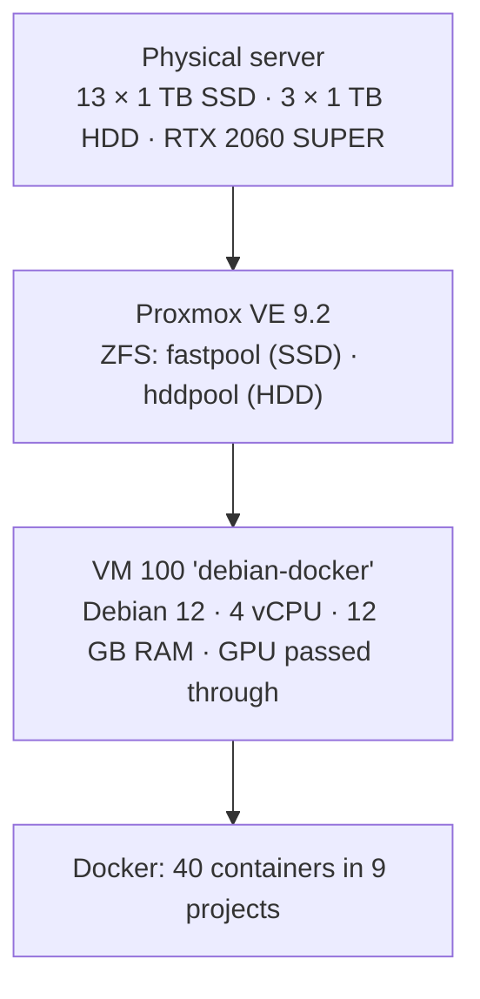
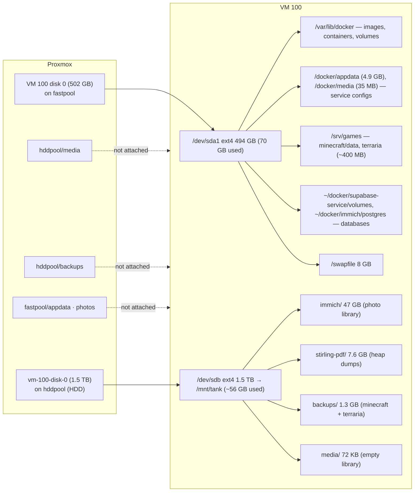

# Host & VM

> The physical Proxmox server and the one Debian VM that runs everything. Last verified 2026-09-26 (from inside the VM). Proxmox-side facts are from the 2026-09-16 inspection unless noted.

## The layers

One VM runs all the Docker containers, rather than one VM or LXC per service. That's a common, sensible homelab design: one OS to patch, one Docker to manage, one GPU owner. The trade-off is that the VM is a single point of failure, which makes VM-level backups important (see the [roadmap](../roadmap/ROADMAP.md)).

## Proxmox host

| Item | Value |
|---|---|
| Proxmox VE | 9.2.x (pve-manager 9.2.4 on 2026-09-16) |
| ZFS `fastpool` | SSD pool, 8.72 TB. Datasets: `appdata`, `photos`, `vms`, and VM 100's boot disk |
| ZFS `hddpool` | HDD pool, **~1.76 TB usable** (checked 2026-09-26; the earlier 2.72 TB was not the usable size). Holds `vm-100-disk-0`, the VM's 1.5 TB data disk. Datasets `backups` and `media` exist but are empty |
| GPU | NVIDIA RTX 2060 SUPER 8 GB, PCIe passthrough to VM 100 (`vfio-pci` on the host) |
| Backup jobs | **none yet** for VM 100 (planned: see below) |

Host RAM (checked 2026-09-26): 16 GB total. VM 12 GB, ZFS read cache (ARC) capped at 1.5 GB (Proxmox default, 10 %) and using ~0.2 GB, the rest is Proxmox. The ARC is not competing with the VM, but there is no spare RAM to give the VM either.

To do on the host (the audit script can't see it): record `qm config 100` and `zpool status`.

### hddpool space and the planned VM backup (2026-09-26)

`zfs list -r hddpool` on the host showed `vm-100-disk-0` (1.46 TB) with a **reservation of the full 1.47 TB** (`refreservation`), although only ~56 GB is written. That left the pool only 291 GB free. The plan:

1. `zfs set refreservation=none hddpool/vm-100-disk-0` frees ~1.4 TB at once, with no downtime. It's safe because deletions inside the VM reach the pool (`discard` works on `sdb`, and the weekly `fstrim.timer` is on).
2. `zfs set quota=600G hddpool/backups` stops backups from ever filling the pool.
3. `pvesm add dir hdd-backups --path /hddpool/backups --content backup --is_mountpoint yes`. The last flag stops Proxmox from writing onto its own boot disk if the dataset isn't mounted.
4. Datacenter → Backup: VM 100, 03:00, snapshot mode, ZSTD, keep-daily 3 + keep-weekly 2 (~100 GB each, ~500 GB total). Then do one test restore to a new VM ID, with the GPU and network removed first.

The pool is then overcommitted (1.5 TB disk + 600 GB quota > 1.76 TB). That's fine at today's usage, but add a "hddpool > 80 % full" alert.

Why hddpool and not fastpool: VM 100's boot disk (all databases, Vaultwarden, configs) lives on fastpool. A backup on the same pool dies with it.

## VM 100 `debian-docker`

| Item | Value (2026-09-25) |
|---|---|
| OS | Debian 12 (bookworm), kernel 6.1.0-52 |
| Machine | QEMU q35, KVM |
| CPU | 4 vCPU, type `host` (shows as i3-12100, AVX2 available). Changed 2026-09-26 |
| RAM | 12 GB, ballooning off, plus an 8 GB swapfile. Swap 5.1 GB used on 2026-09-26, but nothing actively swapping (it was 99 % on 09-25) |
| Disks | `sda` 502 GB (boot), `sdb` 1.5 TB (data at `/mnt/tank`). Details below |
| GPU | RTX 2060 SUPER, NVIDIA driver 615 (open kernel module) + container toolkit 1.20.1. Used by Ollama and Jellyfin |
| QEMU guest agent | **On** in Proxmox and in the VM (2026-09-26) |
| Uptime | rebooted 2026-09-26 ~17:10 |
| Stability | No OOM kills and no CPU stall warnings this boot (the 09-23 boot had both) |

### Core services on the VM

| Service | State | What it does |
|---|---|---|
| `docker` / `containerd` | running | Runs all containers |
| `cloudflared` | running | Cloudflare Tunnel: publishes the portfolio site |
| `tailscaled` | running | Private network access to everything |
| `ssh` | running | Remote login (root + password allowed; see security) |
| `cron` | running | Terraria backup (04:00), Tailscale watchdog every 5 min |
| `certbot.timer` + `snap.certbot.renew.timer` | waiting | Certificate renewal. **Two installs**; keep the snap one |
| `playit` | running | Game tunnel agent. **Duplicate** of the `playit` container |
| `qemu-guest-agent` | running | Lets Proxmox freeze the disks for consistent backups |
| `nginx` (host) | disabled | Old; replaced by the `nginx-proxy` container |
| `avahi-daemon`, `rpcbind` | running | Not needed; can be disabled |

### Host-native programs

Besides Docker, the VM runs a headless browser desktop used by Playwright (browser automation):

- **Xvfb** display `:99` → **x11vnc** on :5900 → **noVNC** (in the browser) on :3010, plus Google Chrome.
- Since 2026-09-25, VNC listens on the **Tailscale IP only** (not the LAN, not IPv6). Start/stop it with `/usr/local/bin/vnc-tailscale.sh [start|stop|status]`. It is **not** started at boot: run it after Xvfb is up.
- Chrome uses ~1 GiB with no limit. The long-term plan is to containerise it with a 1.5 GiB cap and `shm_size: 1gb`. Chrome needs a large `/dev/shm`, and the cap limits it to ~6–8 tabs before a tab (not the browser) is killed.

## Disks and storage

- **Boot disk `sda` (502 GB, 15 % used):** OS, Docker, all databases, app configs, game worlds, swap. It grew from 102 GB after the first inspection, so the old "88 % full" problem is gone.
- **Data disk `sdb` (1.5 TB, ext4 with `discard`, mounted at `/mnt/tank`, created 2026-09-24):** a virtual disk on **hddpool** (the HDDs), confirmed by the owner. Holds bulk files: Immich photos, Stirling data, media, and the in-VM backups.
- **Not attached as datasets:** `hddpool/media`, `hddpool/backups`, `fastpool/photos`, `fastpool/appdata`. Media and backups already live on the HDDs through `sdb`, so that goal is met. There are no ZFS/NFS mounts inside the VM. `/mnt/media` and `/mnt/photos` are empty folders on the boot disk, prepared but never used.

Which path belongs to which app: [services/README.md → Where data lives](../services/README.md#where-data-lives).

### Recommended storage alignment

| Move | To | How | Why |
|---|---|---|---|
| ~~`/mnt/tank/media`, `/mnt/tank/backups` → HDDs~~ | done | `sdb` is on hddpool (2026-09-24) | ✅ |
| Backups out of the VM | Proxmox backup job → a different disk or off-site | vzdump/PBS | A VM backup must not depend on the VM itself |
| `/mnt/tank/immich` | `fastpool/photos` | NFS export or dedicated disk | The dataset was made for this; allows ZFS snapshots of just the photos |
| `/docker`, `/srv/games`, database dirs | `fastpool/appdata` | dedicated disk mounted at `/docker` | Separates app state from the OS for snapshots and restores |
